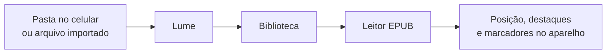

<p align="center">
  
</p>

<h1 align="center">Lume</h1>

<p align="center"><strong>Seu leitor de EPUB, calmo e offline.</strong><br>
Abra o livro, continue de onde parou, grife o que importa.</p>

<p align="center">
  
  
  
  
</p>

<p align="center">
  <a href="releases/Lume.apk"><strong>Baixar o APK</strong></a>
  · pacote <code>com.helio.lume</code>
  · interface em português do Brasil
</p>

---

## Por que o Lume

O Lume é um leitor para o celular, no espírito de um Kindle, feito para ler com calma. Não tem loja, não tem anúncios e não pede conta. Você aponta uma pasta com os seus EPUBs (ou importa um arquivo) e a biblioteca aparece em lista, com capa, título, autor e o quanto você já leu.

Na primeira abertura há livros de demonstração em domínio público (Machado de Assis e José de Alencar), só para você ver o app funcionando. Depois, use a sua própria pasta.

## Download

O APK de release fica neste repositório:

- [releases/Lume.apk](releases/Lume.apk)

1. Baixe o arquivo no celular Android (7 ou mais novo).
2. Abra-o e permita **instalar apps desta fonte** quando o sistema pedir.
3. Abra o **Lume**, toque em **Ajustes** e escolha a **pasta de livros**, ou use o **+** para importar um EPUB.

A chave de assinatura fica só na máquina que gera o APK (`android/key.properties`) e **não** entra no git. Guarde um backup dessa chave: sem ela, uma atualização futura não pode ser instalada por cima desta.

## Telas

| Biblioteca | Pasta nos ajustes | Leitor (sépia) |
|---|---|---|
|  |  |  |

| Tema preto | Seleção e cores | Caderno |
|---|---|---|
|  |  |  |

| Aparência | Sumário | Ajustes de leitura |
|---|---|---|
|  |  |  |

Há ainda o tema verde claro e a aba de marcadores (`docs/screenshots/06_leitor_verde_lora.png` e `09_caderno_marcadores.png`). Os prints são das telas reais do app, no tamanho do moto g 9 plus (1080×2400), com livros de demonstração.

## O que o app faz

- **Biblioteca em lista.** Capa (quando o EPUB tem), título, autor, de onde veio o livro (pasta ou importado), barra de progresso ou a etiqueta *Novo*. Puxe para baixo para atualizar.
- **Continuar leitura.** Uma prateleira no topo com os livros em andamento, do mais recente para o mais antigo.
- **Pasta de livros.** Em *Ajustes* você escolhe uma pasta do celular. O Lume procura arquivos `.epub` nela e nas subpastas, ignora o resto e não lista o mesmo livro duas vezes. O caminho fica salvo.
- **Atualizar automaticamente.** Com a opção ligada, livros novos na pasta entram sozinhos na biblioteca. A pasta também é relida quando o app volta à tela.
- **Importar.** O botão **+** copia um EPUB para a pasta do app, se você preferir não usar uma pasta compartilhada.
- **Retomar a posição.** Cada livro guarda o parágrafo e o ponto da leitura. Ao reabrir, você volta exatamente dali.
- **Marca-texto.** Selecione um trecho e escolha amarelo, laranja, rosa ou azul (como no Kindle). Dá para anexar uma nota, copiar ou remover. Destaques com nota ficam sublinhados. Tudo é salvo no celular.
- **Caderno.** Lista os destaques (com filtro por cor) e os marcadores. Tocar num item salta para aquele trecho. Dá para editar a nota, mudar a cor ou apagar.
- **Aparência.** Temas de página branco, sépia, verde claro e preto; fontes Literata, Lora ou Source Sans; tamanho, espaçamento, margens, alinhamento e modo de leitura (rolagem contínua ou virar página, tocando nas bordas).
- **Sumário.** Capítulos do livro, com o atual marcado e a porcentagem de cada um.
- **Barra de progresso.** Mostra a % do livro e uma estimativa do tempo restante no capítulo.

PDF, loja de livros e conta na nuvem ficam de fora desta versão.

## Como funciona



O Lume lê o EPUB no próprio app (é um ZIP com o texto do livro). Ele abre o pacote, lê o título, o autor e a capa, percorre os capítulos e mostra o texto em Flutter — sem internet.

```
lib/
  epub.dart       lê o EPUB (OPF, capítulos, capa, sumário)
  library.dart    junta a pasta escolhida com os livros importados
  store.dart      guarda posição, destaques, marcadores e preferências
  screens/        biblioteca, leitor, caderno, aparência e ajustes
assets/fonts/     Literata, Lora e Source Sans 3 (licença SIL OFL)
demo_folder/      4 EPUBs de exemplo para copiar ao celular
docs/screenshots/ prints das telas
releases/         APK de release
```

## Design

- Fundo cor de papel creme, tinta em carvão-marrom, acento terracota e âmbar.
- Texto do livro em fonte serifada (Literata, com Lora como opção); interface em Source Sans 3.
- Cartões suaves, margens generosas, entrelinha folgada e movimento discreto (Material 3).
- Cores do marca-texto alinhadas ao Kindle: amarelo, laranja, rosa e azul.

## Instalação e compilação

Requisitos para gerar o APK: Flutter 3, JDK 17 e Android SDK.

```bash
flutter pub get
flutter test
flutter build apk --release
# saída: build/app/outputs/flutter-apk/app-release.apk
# cópia: releases/Lume.apk
```

Para rodar no celular em modo de desenvolvimento:

```bash
flutter run
```

Copie a pasta `demo_folder/` para o aparelho e escolha-a em *Ajustes → Pasta de livros*.

O build de release usa `android/key.properties` (ignorado pelo git). Sem esse arquivo, o Gradle usa a chave de debug, só para desenvolvimento.

Para atualizar os prints:

```bash
flutter test --update-goldens
```

## Limitações

- Um destaque não atravessa dois parágrafos.
- O leitor ignora o CSS e as imagens internas do livro e mantém títulos, parágrafos, itálico e negrito. A capa aparece na biblioteca.
- *Virar página* avança uma tela por toque, sem animação de folha e sem colunas de página.
- Se o arquivo EPUB for trocado por outra edição, a posição e os destaques podem cair em outro parágrafo (não usamos CFI).
- O tempo restante no capítulo é uma estimativa (cerca de 1.000 caracteres por minuto).
- No Android 11 ou mais novo, ler uma pasta qualquer pede *Acesso a todos os arquivos*. Para a Play Store, o caminho natural seria o seletor padrão de pastas do Android (SAF).
- Só EPUB nesta versão.
- Alguns EPUBs do Project Gutenberg abrem na página de licença em inglês antes do texto do livro.

## Segurança e privacidade

- Tudo roda no celular. Não há conta, servidor nem anúncio.
- Posição de leitura, destaques, notas, marcadores e o caminho da pasta ficam só no aparelho.
- A chave que assina o APK não é publicada neste repositório.

## Créditos

Livros de exemplo (domínio público), do [Project Gutenberg](https://www.gutenberg.org):

- *Dom Casmurro* (#55752), *Quincas Borba* (#55682) e *Memorias Posthumas de Braz Cubas* (#54829), de Machado de Assis
- *Iracema* (#67740), de José de Alencar

Os arquivos mantêm o cabeçalho e a licença do Project Gutenberg. As fontes Literata, Lora e Source Sans 3 estão sob a SIL Open Font License 1.1 (`assets/fonts/OFL-*.txt`).

## Licença do código

© 2026 Hélio Rosado Neto. Ainda não foi escolhida uma licença de código aberto, então todos os direitos estão reservados.
