# Lume

Leitor de EPUB para Android, calmo e offline, no estilo Kindle. Feito em Flutter. Status: **protótipo navegável** (sem APK publicado).

- Pacote: `com.helio.lume`
- Interface em português do Brasil
- Offline, sem conta e sem anúncios

## O que funciona

| Recurso | Como |
|---|---|
| **Biblioteca em lista** | Capa, título, autor, origem (pasta ou importado) e progresso. Puxe para baixo para atualizar. |
| **Pasta de livros** | Em *Ajustes → Pasta de livros*, escolha uma pasta. O Lume procura EPUBs nela e nas subpastas. O caminho fica salvo. Com *Atualizar automaticamente* ligado, livros novos aparecem sozinhos (observação da pasta) e a lista também é relida quando o app volta ao primeiro plano. |
| **Continuar leitura** | Prateleira no topo da biblioteca com os livros em andamento, do mais recente para o mais antigo. |
| **Importar EPUB** | Botão **+** na biblioteca (seletor de arquivos). O arquivo é copiado para a pasta do app. |
| **Leitor** | Texto serifado (Literata, Lora ou Source Sans), rolagem contínua ou modo *virar página* (toque nas bordas), barra de progresso com % do livro e minutos restantes no capítulo. |
| **Retomar posição** | A posição de cada livro (parágrafo + deslocamento) é salva enquanto você lê e restaurada ao reabrir. |
| **Marca-texto** | Selecione um trecho e escolha amarelo, laranja, rosa ou azul. Também dá para criar nota, copiar ou remover. Os destaques ficam salvos. |
| **Caderno** | Lista de destaques (com filtro por cor, nota, mudar cor, excluir) e de marcadores. Tocar leva ao trecho. |
| **Marcadores** | Ícone de marcador no topo do leitor. |
| **Aparência** | Temas de página branco, sépia, verde claro e preto, além de fonte, tamanho, entrelinha, margens, alinhamento e modo de leitura. |
| **Sumário** | Lê o NCX (EPUB 2) ou o nav (EPUB 3), marca o capítulo atual e mostra a % de cada capítulo. |

## Telas

| Biblioteca (pasta) | Ajustes: pasta | Ajustes: leitura |
|---|---|---|
| 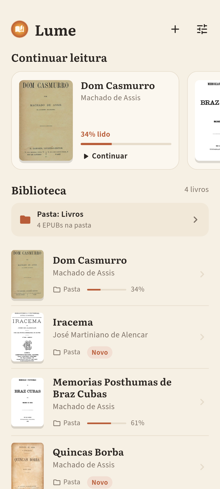 | 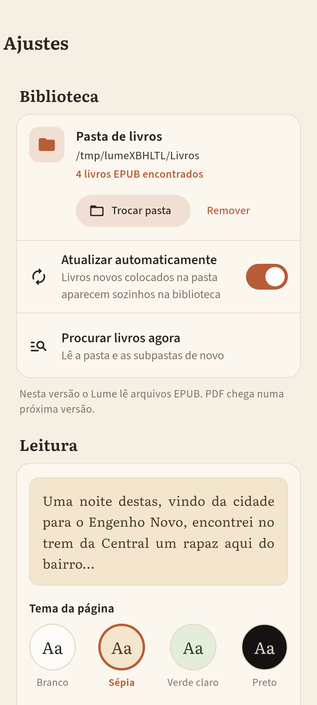 | 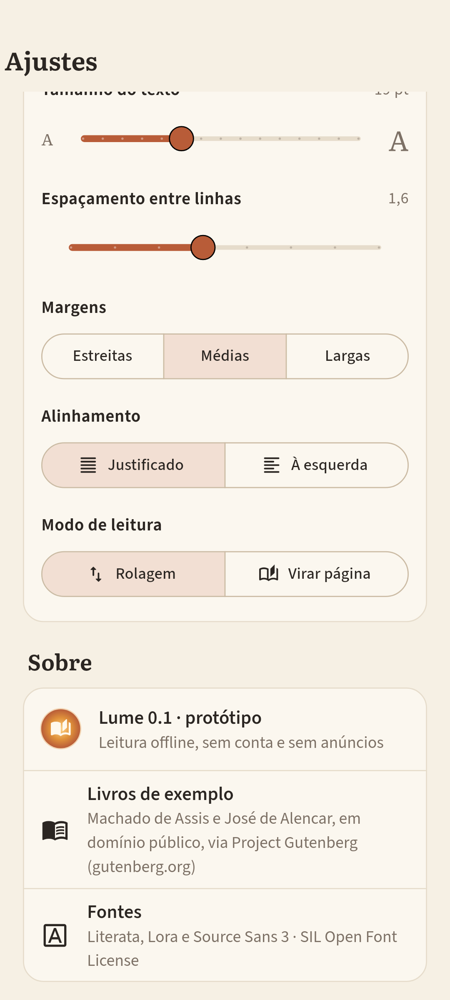 |

| Leitor sépia | Leitor preto | Verde claro + Lora |
|---|---|---|
| 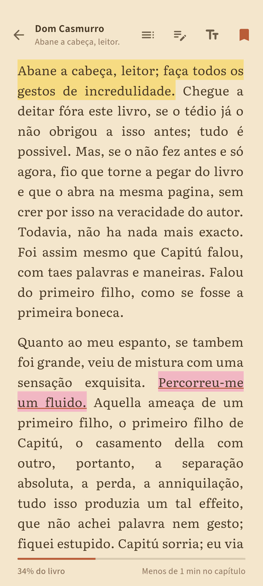 | 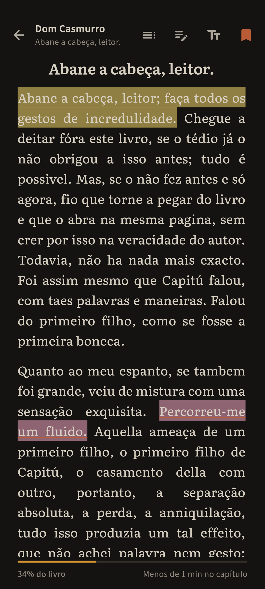 | 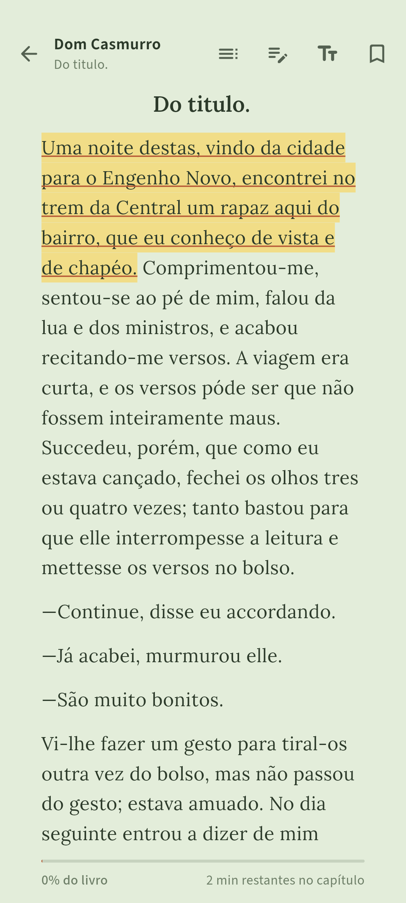 |

| Seleção e cores | Caderno: destaques | Caderno: marcadores |
|---|---|---|
| 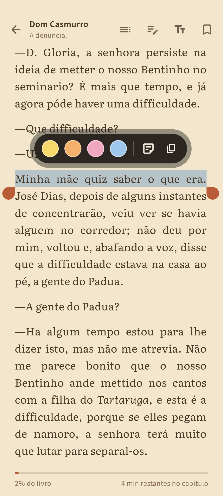 | 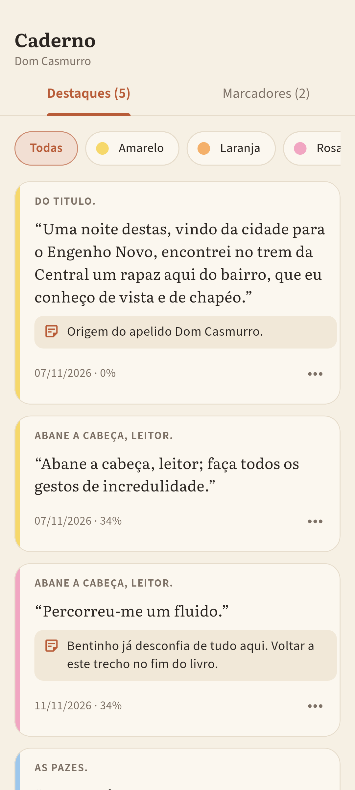 | 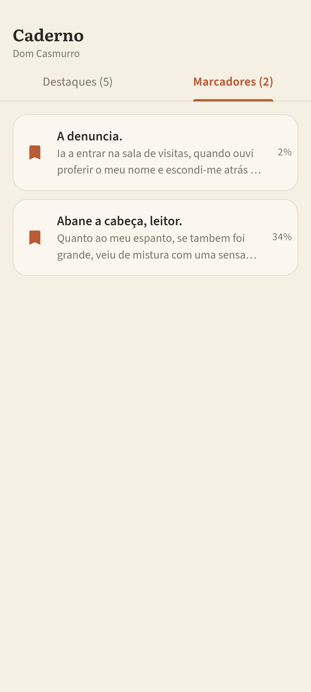 |

| Aparência | Sumário |
|---|---|
| 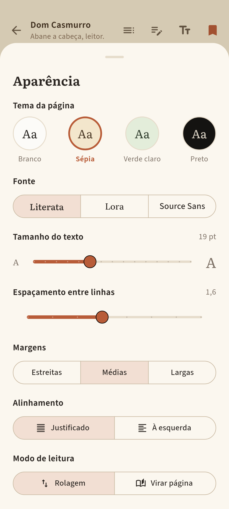 | 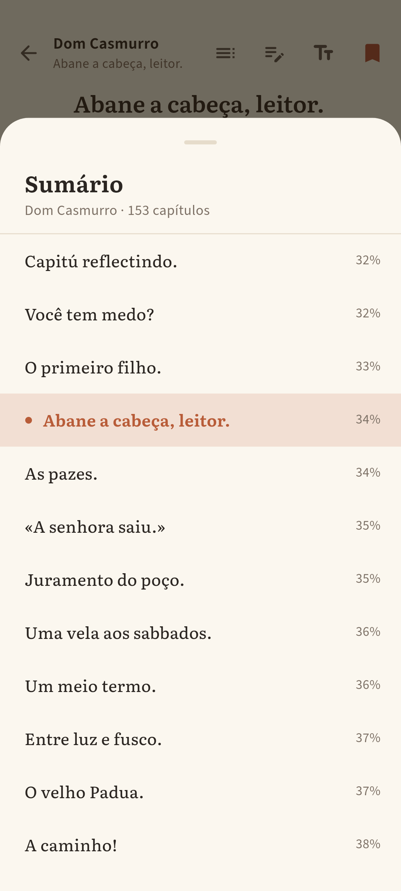 |

Os prints são gerados pelos testes de tela (`test/screens_test.dart`). Eles renderizam os widgets reais, com as fontes do app e livros reais, em 1080×2400 (moto g9 plus). Para regravar:

```bash
flutter test --update-goldens
```

## Design

- Papel creme `#F6F0E4`, tinta carvão-marrom `#2B2622`, acento terracota `#B85C38` e âmbar `#D9932F`.
- Texto do livro em **Literata** (serifada), interface em **Source Sans 3**, e **Lora** como opção de leitura.
- Cartões suaves, margens generosas, entrelinha folgada e transições discretas (Material 3).
- As cores do marca-texto seguem o Kindle: amarelo, laranja, rosa e azul.

## Arquitetura

- `lib/epub.dart`: leitor de EPUB próprio. Usa `archive`, `xml` e `html` para abrir o ZIP, ler o OPF (título, autor, capa), percorrer o spine e transformar o XHTML em blocos (títulos e parágrafos com itálico e negrito). Mapeia as âncoras para o sumário.
- `lib/library.dart`: biblioteca. Junta os livros importados com os da pasta escolhida (busca recursiva em isolate), tira duplicados pelo `dc:identifier` e observa a pasta com `Directory.watch`.
- `lib/store.dart`: persistência local com `shared_preferences`. Guarda posição, destaques, marcadores, preferências e a pasta.
- `lib/screens/`: biblioteca, leitor, caderno, aparência e ajustes.
- O leitor usa `scrollable_positioned_list` para pular para um parágrafo e saber qual está no topo. Cada parágrafo é um `SelectableText` com barra de seleção própria (as 4 cores, nota, copiar e remover).

### Por que um leitor próprio, e não `flutter_epub_viewer`?

Os plugins de EPUB com WebView (por exemplo `flutter_epub_viewer`, com CFI) não rodam em testes de widget nem no Linux. Por isso não dariam prints reais nem testes automáticos aqui. O renderizador próprio é 100% Flutter e funciona em qualquer plataforma. Posição e destaques são salvos como *parágrafo + deslocamento de caracteres*, e não como CFI do EPUB.

## Limitações conhecidas

- **Seleção dentro de um parágrafo só:** um destaque não atravessa dois parágrafos.
- **Formatação simplificada:** o leitor ignora CSS e imagens internas do livro e mantém só títulos, parágrafos, itálico e negrito. A capa aparece na biblioteca.
- **Modo "virar página" rola uma tela por toque:** não há paginação real em colunas nem animação de folha.
- **Posição presa a esta versão do arquivo:** se o EPUB mudar (outra edição), posição e destaques podem cair em outro parágrafo, porque não são CFI.
- **Tempo restante no capítulo é estimado:** a conta usa ~1000 caracteres por minuto.
- **Pasta no Android:** no Android 11 ou mais novo, ler uma pasta qualquer exige *Acesso a todos os arquivos* (`MANAGE_EXTERNAL_STORAGE`), que o app pede ao escolher a pasta. Para publicar na Play Store seria melhor migrar para o Storage Access Framework (SAF). A observação automática da pasta depende do sistema de arquivos, e por isso o app também relê a pasta ao voltar ao primeiro plano.
- **Só EPUB por enquanto.** PDF fica para a próxima versão.
- **Ainda não testado em aparelho:** os prints vêm dos testes de widget. Também não foi feito build de Android nem de Linux nesta máquina.

## Créditos

- Livros de exemplo (domínio público), do [Project Gutenberg](https://www.gutenberg.org):
  *Dom Casmurro* (#55752), *Quincas Borba* (#55682) e *Memorias Posthumas de Braz Cubas* (#54829), de Machado de Assis; *Iracema* (#67740), de José de Alencar; *Os Lusíadas* (#3333), de Luís de Camões (só nos testes). Os arquivos mantêm o cabeçalho e a licença do Project Gutenberg.
- Fontes: Literata, Lora e Source Sans 3, sob a SIL Open Font License 1.1 (`assets/fonts/OFL-*.txt`).

## Rodar

```bash
flutter pub get
flutter test          # 15 testes (EPUB, biblioteca, leitor, destaques, posição)
flutter run           # celular Android conectado
```

A pasta `demo_folder/` tem 4 EPUBs de exemplo. Copie-a para o celular e escolha-a em *Ajustes → Pasta de livros*.
