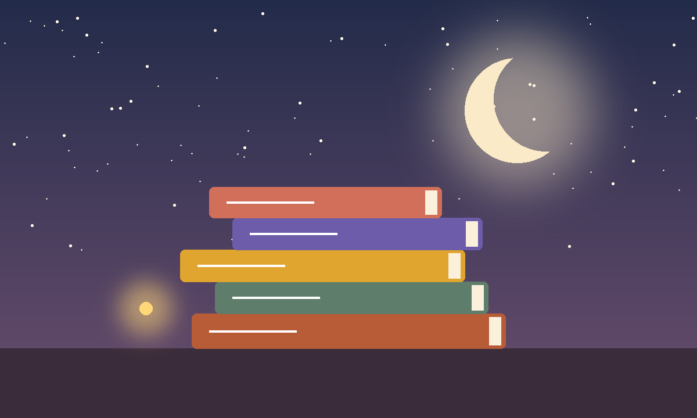

# Caderno de leitura

Um pequeno guia, escrito para o Lume, de como ler com **calma** e guardar o que *importa*. Veja também [como marcar trechos](#como-marcar-trechos) e o [Project Gutenberg](https://www.gutenberg.org), onde moram os livros de domínio público.

## Antes de começar

- Escolha um lugar com boa luz.
- Deixe o celular no modo *não perturbe*.
- Tenha à mão:
  1. o livro da vez;
  2. um caderno, de papel ou no app;
  3. uma xícara de chá.

> Ler devagar não é ler menos. É deixar a frase terminar de acontecer antes de passar para a próxima.
>
> — anotação de um leitor

## Como marcar trechos

Selecione o texto e escolha uma das quatro cores. Para lembrar a cor de cada assunto, use a tabela:

| Cor | Para quê |
|:--|:--|
| Amarelo | ideias principais |
| Laranja | dúvidas |
| Rosa | frases bonitas |
| Azul | nomes e datas |



## Para quem gosta de código

Os destaques ficam salvos no aparelho. Um destaque é, por dentro, algo assim:

```dart
final destaque = Highlight(
  cor: HighlightColor.amarelo,
  texto: 'Ler devagar não é ler menos.',
  nota: 'Lembrar disso nas férias',
);
```

Use `Ajustes → Pasta do Lume` para saber onde ficam os seus arquivos.

---

## Lista de tarefas

- [x] Terminar *Dom Casmurro*
- [ ] Começar *Iracema*
- [ ] Reler os destaques de ~~ontem~~ hoje

Boa leitura!
